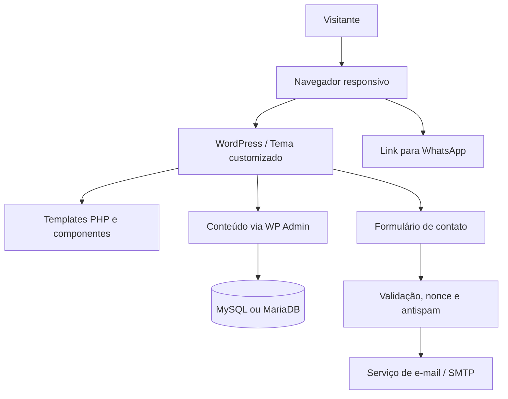

# Projeto 01 — ESO Arquitetura | Site Institucional

> **Tipo:** projeto demonstrativo de portfólio | **Status:** planejamento | **Stack:** WordPress, PHP, HTML5, CSS3 e JavaScript

## 1. Visão geral

Desenvolver um site institucional moderno, responsivo e de alta qualidade para a **ESO Arquitetura**, marca conceitual de um escritório de arquitetura (projeto demonstrativo). O site deve comunicar competência técnica, cuidado estético e confiança, apresentar projetos e serviços e facilitar o contato comercial.

**Direção:** editorial e arquitetônica, com composição deliberada, fotografias de obras, boa hierarquia tipográfica e microinterações discretas. Evitar aparência de template genérico ou layout artificialmente produzido: sem excesso de gradientes, cards repetitivos, sombras exageradas, ícones decorativos e animações gratuitas.

**Público-alvo:** pessoas e empresas que procuram projetos arquitetônicos, projetos complementares, reformas, acompanhamento de obras e consultoria técnica.

**Objetivos do MVP:**
- Apresentar a empresa e seu posicionamento.
- Exibir serviços e projetos realizados (no portfólio demonstrativo, utilizar **cases fictícios claramente identificados**).
- Captar contatos por formulário e WhatsApp.
- Oferecer navegação rápida, acessível e agradável em desktop e celular.
- Permitir que o conteúdo seja atualizado pelo painel WordPress.

## 2. Identidade visual e UI

### 2.1 Paleta

| Papel | Cor | HEX | Aplicação |
|---|---|---|---|
| Primária | Azul profundo | `#122C40` | Header, títulos, botões principais e seções de destaque |
| Primária escura | Azul noturno | `#0D2334` | Rodapé e overlays |
| Secundária | Amarelo dourado | `#E8B44C` | Pequenos detalhes, linhas, tags e estados de destaque |
| Fundo | Off-white | `#F7F6F2` | Fundo principal |
| Superfície | Branco | `#FFFFFF` | Conteúdo e formulários |
| Texto | Grafite | `#252B30` | Texto corrido |
| Texto secundário | Cinza | `#626C73` | Legendas e metadados |

**Regra de uso:** azul e neutros dominam; amarelo é acento, não preenchimento de grandes áreas. Conferir contraste WCAG antes de definir texto sobre amarelo e azul.

### 2.2 Tipografia

- **Títulos:** `Manrope` (600–700) ou `Plus Jakarta Sans` (600–700), sem serifa, limpa e contemporânea.
- **Corpo:** `Inter` (400–500), com altura de linha entre 1.55 e 1.7.
- Usar no máximo duas famílias tipográficas, preferencialmente hospedadas localmente e com pesos limitados.
- Títulos com escala responsiva usando `clamp()`; evitar texto todo em caixa alta em blocos longos.

### 2.3 Direção de layout

- Grid de 12 colunas no desktop e layout fluido no mobile.
- Container central de até `1200px` (com margens laterais responsivas).
- Espaçamentos consistentes (escala de 8px); seções com respiro generoso.
- Hero com imagem arquitetônica marcante e headline curta, **sem clichês de marketing**.
- Alternância entre blocos de texto e imagens amplas, com alinhamentos intencionais.
- Portfólio em grade editorial assimétrica ou grade simples com boas proporções de imagem; evitar carrosséis automáticos.
- Bordas discretas, poucos raios arredondados, sem glassmorphism ou sombras pesadas.
- Animações leves (150–250ms), respeitando `prefers-reduced-motion`.
- Fotografias autênticas/licenciadas; nunca apresentar imagens geradas ou cases fictícios como obras reais.

### 2.4 Referência de tom

**Exemplo de hero da ESO Arquitetura:**

> **ESO Arquitetura. Espaços que revelam novas perspectivas.**  
> Arquitetura e engenharia com atenção ao espaço, à técnica e às pessoas.  
> `[Conheça nossos projetos]` `[Solicite um orçamento]`

*Texto demonstrativo; usar linguagem própria, sem copiar os textos do site de referência.*

### 2.5 Referência visual aprovada — direção ESO

As capturas enviadas definem a direção visual: header off-white com assinatura tipográfica `eso.` e descritor `ARQUITETURA`; hero quase em tela cheia com fotografia de arquitetura, título grande alinhado à esquerda e texto de apoio à direita; portfólio em composição assimétrica com imagens amplas, números e legendas pequenas; seção de atuação com accordion; CTA final em azul profundo com destaque amarelo.

**Diretrizes específicas:**
- Logo tipográfico original `eso.` em azul com ponto amarelo; não copiar marca ou elementos exclusivos de terceiros.
- Hero com altura aproximada de `min(780px, 85svh)` no desktop, sobreposição escura sutil para contraste e alternativa em mobile com texto em área segura.
- Menu: `Projetos`, `Essência`, `Atuação` e `Vamos conversar`; links âncora na home e páginas próprias de projetos.
- Projetos: imagens em proporções e alturas variadas, sem molduras de cards; metadados discretos e ícone de seta.
- Atuação: accordion acessível com três entradas: `Arquitetura`, `Interiores` e `Corporativo`; conteúdos editáveis no WordPress.
- Rodapé/CTA: fundo `#122C40`, texto off-white e uma única linha em `#E8B44C`.
- Tipografia sugerida: `Manrope` para navegação e corpo; `DM Sans` ou `Manrope` para títulos, com peso leve/moderado e bom espaçamento. Testar visualmente antes de fixar.
- Mobile: menu recolhível, hero com imagem recortada de forma intencional, projetos em coluna única e accordion em largura total.
- **Originalidade:** a referência serve para hierarquia e atmosfera, não para reproduzir exatamente imagens, textos, composição ou identidade visual de outro escritório.

## 3. Mapa do site

```text
/
├── Início
├── Sobre
├── Serviços
│   └── Detalhe de serviço (opcional no MVP)
├── Projetos
│   └── Detalhe de projeto (template dinâmico)
├── Contato
├── Política de Privacidade
└── Página 404
```

**Menu principal:** Projetos, Essência, Atuação. CTA de destaque: **Vamos conversar**. Páginas complementares: projetos individuais, contato e privacidade.

## 4. Funcionalidades do MVP

### 4.1 Página inicial
- Header responsivo, navegação acessível e CTA de contato.
- Hero com foto otimizada, headline e dois CTAs.
- Resumo institucional com link para Sobre.
- Seção Atuação com accordion: Arquitetura, Interiores e Corporativo.
- Projetos em destaque (3 itens, gerenciáveis no WordPress) em grid editorial assimétrico.
- Bloco de processo de trabalho (briefing → projeto → acompanhamento).
- Chamada final para orçamento.
- Rodapé com contatos, links e informações legais.

### 4.2 Sobre
- Apresentação do escritório fictício, valores e metodologia.
- Seção sobre a equipe **sem inventar profissionais reais, registros ou credenciais**.
- Foto institucional licenciada ou composição gráfica própria.

### 4.3 Serviços
- Listagem de serviços: projeto arquitetônico, projetos complementares, reforma e consultoria técnica (conteúdo ilustrativo).
- Descrição objetiva de cada serviço e CTA de orçamento.
- Conteúdo editável pelo painel WordPress.

### 4.4 Projetos
- **Custom Post Type `projeto`**.
- Campos: título, resumo, tipo, localização aproximada fictícia, ano fictício, área (opcional), descrição, imagem de capa e galeria.
- Página de listagem e template individual.
- Filtro por categoria somente se couber no prazo; pode ficar para a versão 2.
- Identificação visível: **“Projeto conceitual/demonstrativo”** quando aplicável.

### 4.5 Contato
- Formulário: nome, e-mail, telefone (opcional), tipo de serviço, mensagem e consentimento de privacidade.
- Validação no cliente **e** no servidor, sanitização, proteção antispam e feedback de envio.
- Envio por mecanismo confiável de e-mail transacional/SMTP configurado no ambiente.
- Link para WhatsApp com mensagem pré-preenchida e abertura explícita do aplicativo.
- Informações de contato fictícias e claramente marcadas no ambiente de demonstração.

### 4.6 Requisitos globais
- Layout mobile-first e adaptado a telas pequenas, médias e grandes.
- Menu mobile com teclado, foco visível e estado expandido anunciado.
- Metadados SEO por página, títulos semânticos e URLs amigáveis.
- Imagens responsivas (`srcset`, tamanhos corretos, lazy loading abaixo da dobra).
- Estados de carregamento, erro, sucesso e formulário enviado.
- Página 404 personalizada.

## 5. Arquitetura técnica

### 5.1 Abordagem

**WordPress tradicional com tema customizado** (sem SPA). Escolha adequada para um site institucional, por simplicidade de deploy, SEO, custo e edição de conteúdo. Não usar Vue ou .NET apenas para aumentar a stack: eles serão demonstrados nos próximos projetos do portfólio.



### 5.2 Separação de responsabilidades

- **Tema:** layout, templates, estilos, scripts e apresentação.
- **Plugin de funcionalidades do projeto:** registro de Custom Post Types, taxonomias e metadados estruturados, evitando que dados dependam do tema ativo.
- **WordPress Admin:** edição de páginas, serviços e projetos.
- **Banco:** armazenamento padrão do WordPress, sem tabelas customizadas no MVP.
- **Formulário:** usar solução confiável e bem mantida ou endpoint próprio seguro, com política de privacidade adequada.

### 5.3 Estrutura de repositório sugerida

```text
arquitetura-engenharia-site/
├── README.md
├── docs/
│   ├── arquitetura.md
│   ├── identidade-visual.md
│   └── screenshots/
├── wp-content/
│   ├── themes/
│   │   └── atelier-theme/
│   │       ├── style.css
│   │       ├── functions.php
│   │       ├── header.php
│   │       ├── footer.php
│   │       ├── front-page.php
│   │       ├── home.php
│   │       ├── page.php
│   │       ├── archive-projeto.php
│   │       ├── single-projeto.php
│   │       ├── 404.php
│   │       ├── template-parts/
│   │       │   ├── hero.php
│   │       │   ├── services.php
│   │       │   ├── project-card.php
│   │       │   └── cta.php
│   │       ├── assets/
│   │       │   ├── css/
│   │       │   ├── js/
│   │       │   ├── fonts/
│   │       │   └── images/
│   │       └── inc/
│   │           ├── setup.php
│   │           ├── enqueue.php
│   │           └── helpers.php
│   └── plugins/
│       └── atelier-core/
│           ├── atelier-core.php
│           └── includes/
│               ├── post-types.php
│               └── meta-fields.php
├── .gitignore
└── .env.example
```

**Observação:** não versionar o core do WordPress, uploads, backups, banco de dados ou segredos. O exemplo acima representa apenas os arquivos próprios do projeto.

## 6. Componentes e design system

| Componente | Variações / comportamento |
|---|---|
| Header | Desktop e menu mobile acessível; CTA fixo no menu |
| Hero | Foto editorial + texto curto + 1–2 ações |
| Botão | Primário azul, secundário contorno, hover e foco visível |
| ServiceItem | Número, título, resumo e link; sem excesso de cards |
| ProjectCard | Imagem, nome, categoria e ano; hover sutil |
| SectionHeading | Eyebrow opcional, título e texto de apoio |
| ContactForm | Labels persistentes, erros claros e confirmação |
| Footer | Contatos, navegação, privacidade e créditos |

**Breakpoints de referência:** mobile até 767px, tablet 768–1023px, desktop a partir de 1024px. Ajustar pelo conteúdo, não apenas pelo dispositivo.

## 7. Segurança, privacidade e qualidade

- Atualizar WordPress, PHP, tema e plugins; usar apenas dependências confiáveis.
- Sanitizar entradas, escapar saídas, validar permissões e usar nonces onde apropriado.
- Configurar HTTPS, backups e credenciais fora do repositório.
- Limitar spam e abuso no formulário; não expor e-mails ou dados pessoais desnecessariamente.
- Publicar política de privacidade coerente com os dados efetivamente coletados e com a LGPD.
- Garantir navegação por teclado, labels em formulários, contraste suficiente e textos alternativos úteis.
- Objetivos de qualidade: **Lighthouse ≥ 90** em Performance, Accessibility e SEO no ambiente de produção, como metas a validar — não resultados já alcançados.
- Conferir Core Web Vitals em dispositivos reais quando houver tráfego suficiente.

## 8. Conteúdo e assets

- Nome e identidade de marca **fictícios**.
- 3 projetos conceituais com textos, fotos e categorias coerentes.
- 4 serviços com descrições objetivas.
- Fotos próprias ou licenciadas com direito de uso; registrar créditos quando exigidos.
- Não usar logotipos, depoimentos, prêmios, avaliações, clientes ou certificações falsos.
- Conteúdo em português do Brasil.

## 9. Plano de implementação (MVP)

| Etapa | Entregável | Estimativa |
|---|---|---:|
| 1. Definição visual | Paleta, tipografia, wireframes e conteúdo inicial | 2–3h |
| 2. Base WordPress | Ambiente local, tema, menu, estilos e componentes | 3–4h |
| 3. Páginas | Home, Sobre, Serviços, Contato e responsividade | 5–7h |
| 4. Portfólio | CPT, campos, listagem e detalhe de projeto | 3–5h |
| 5. Finalização | Formulário, SEO, acessibilidade, testes e screenshots | 3–5h |
| **Total** | **MVP demonstrativo** | **16–24h** |

Com disponibilidade de **5–10 horas por semana**, estimar **3–5 semanas**, reservando margem para refinamento visual. Evitar incluir recursos fora do MVP antes de concluir os essenciais.

## 10. Critérios de aceite

- [ ] Layout aprovado visualmente em desktop e mobile, sem rolagem horizontal inesperada.
- [ ] Navegação, menus, CTAs e links funcionam.
- [ ] Conteúdo de serviços e projetos pode ser atualizado pelo painel WordPress.
- [ ] Três projetos demonstrativos aparecem na listagem e nas páginas individuais.
- [ ] Formulário valida dados e confirma envio, com entrega de e-mail testada.
- [ ] Menu e formulário são utilizáveis por teclado.
- [ ] Imagens estão otimizadas e textos possuem contraste adequado.
- [ ] Página 404, metadados e política de privacidade estão presentes.
- [ ] Nenhum segredo, dado pessoal real ou arquivo sensível foi commitado.
- [ ] README possui instruções de instalação, screenshots e identificação como projeto fictício.

## 11. Publicação e portfólio

### GitHub

**Nome do repositório:** `architecture-engineering-wp`  
**Descrição curta:** `Site institucional responsivo para escritório fictício de arquitetura e engenharia, desenvolvido com WordPress e tema PHP personalizado.`

No `README.md`, incluir:
1. Imagem de capa real do projeto concluído.
2. Contexto e objetivo.
3. Stack e decisões de arquitetura.
4. Funcionalidades implementadas (não planejadas).
5. Como executar localmente.
6. Capturas de tela desktop/mobile.
7. Link de demonstração, se disponível.
8. Aviso de que a empresa e os cases são fictícios.

### 99Freelas / Workana

**Título sugerido:** `Site Institucional para Arquitetura e Engenharia | WordPress`

**Descrição sugerida após a conclusão:**

> Projeto demonstrativo de site institucional para escritório fictício de arquitetura e engenharia, com layout responsivo, identidade visual personalizada, páginas de serviços, portfólio de projetos gerenciável pelo WordPress e formulário de contato. Desenvolvido com tema próprio em PHP, HTML, CSS e JavaScript, priorizando experiência de navegação, acessibilidade e desempenho.

**Imagens a publicar:** home desktop, home mobile, grade de projetos, detalhe de projeto e contato. Não anunciar funcionalidades ainda não concluídas.

## 12. Versão 2 (fora do MVP)

- Filtros dinâmicos por tipo de projeto.
- Blog com artigos técnicos e editoriais.
- Multilíngue.
- Integração com CRM ou automação de leads.
- Animações de transição cuidadosamente controladas.
- Painel de métricas com consentimento e privacidade adequados.

---

**Próxima etapa prática:** criar wireframe da home (desktop e mobile), definir nome fictício do escritório e selecionar imagens licenciadas. Depois iniciar o tema customizado e os componentes base.
