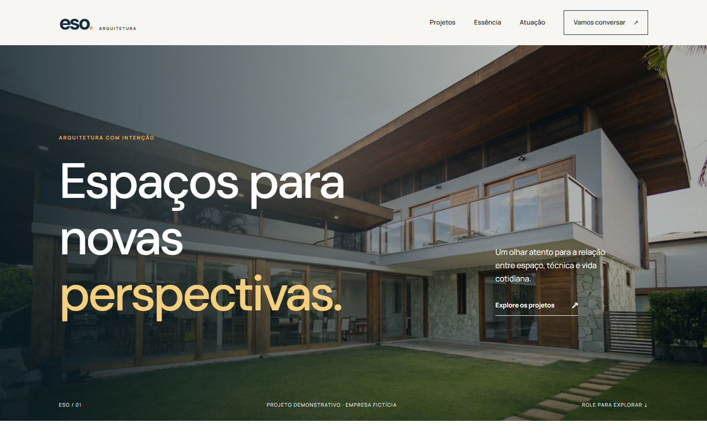
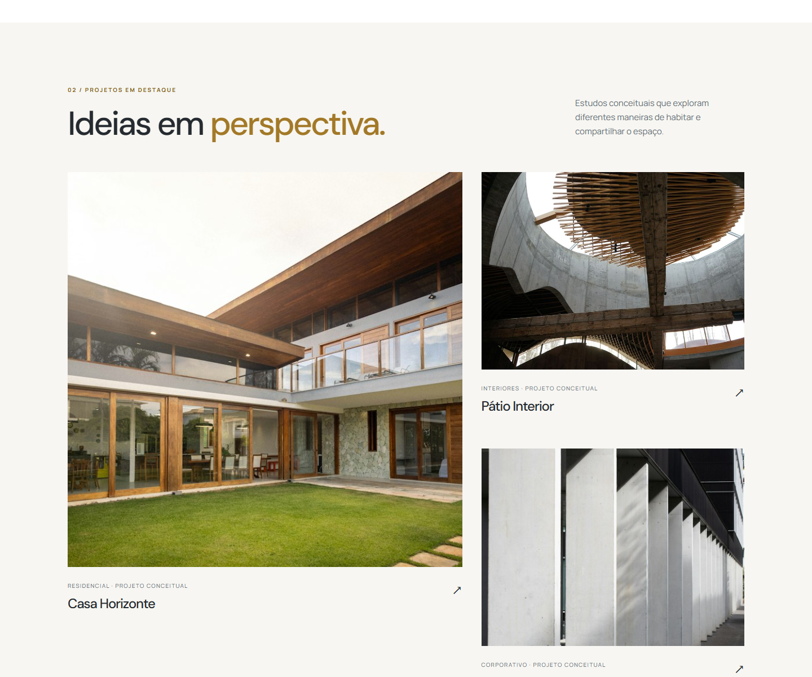
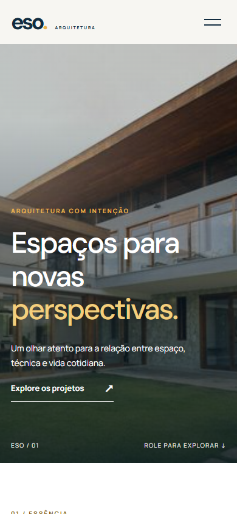

# ESO Arquitetura

Site institucional de arquitetura feito em WordPress. A ideia foi criar uma presença digital que mostrasse o trabalho do escritório com clareza e deixasse o caminho até o contato simples para quem visita.

## O que o site oferece

- **Portfólio fácil de explorar:** projetos em uma grade visual, cada um com página própria, descrição e dados como tipo, localização, ano e área.
- **Serviços bem apresentados:** páginas de serviços e áreas de atuação para o visitante entender o que o escritório faz antes de entrar em contato.
- **Contato direto:** formulário com validação e proteção contra envios repetidos, além de um link de WhatsApp quando o número estiver configurado.
- **Conteúdo editável:** projetos, serviços, áreas de atuação e imagens podem ser atualizados pelo painel do WordPress.
- **Experiência em celular:** navegação, imagens e seções adaptadas a telas menores.

### Projetos

### Versão mobile

## Sobre este projeto

O site está implementado e funciona no ambiente Local. Os sete projetos exibidos são estudos conceituais usados para mostrar a experiência do portfólio. As fotografias são referências visuais licenciadas, não obras executadas pela ESO; os [créditos das imagens](docs/imagens.md) estão documentados.

Criei um tema próprio para a interface e um plugin para os tipos de conteúdo e o formulário, sem usar page builder.

## Tecnologias

- **WordPress:** gerenciamento de páginas, projetos, serviços e imagens.
- **PHP:** templates do tema, plugin próprio e processamento do formulário.
- **HTML5, CSS3 e JavaScript:** estrutura, visual responsivo e interações da interface.
- **Local e Mailpit:** ambiente de desenvolvimento e verificação dos e-mails enviados pelo `wp_mail`.

Como executar no Local

1. Crie um site chamado `eso-arquitetura` no [Local](https://localwp.com/) e instale o WordPress.
2. Copie `wp-content/themes/eso-arquitetura` para `app/public/wp-content/themes/` e `wp-content/plugins/eso-core` para `app/public/wp-content/plugins/` dentro da pasta do site.
3. No painel do WordPress, ative o tema **ESO Arquitetura** e o plugin **ESO Core**. O plugin cria as páginas e o conteúdo inicial.
4. Em **Configurações → Links permanentes**, selecione **Nome do post** e salve.

O repositório contém o tema, o plugin e a documentação. O WordPress, o banco de dados e os uploads ficam na instalação local.

Para publicar em um domínio, ainda é preciso configurar a entrega dos e-mails, informar os contatos definitivos e revisar a Política de Privacidade conforme o uso real do formulário.
